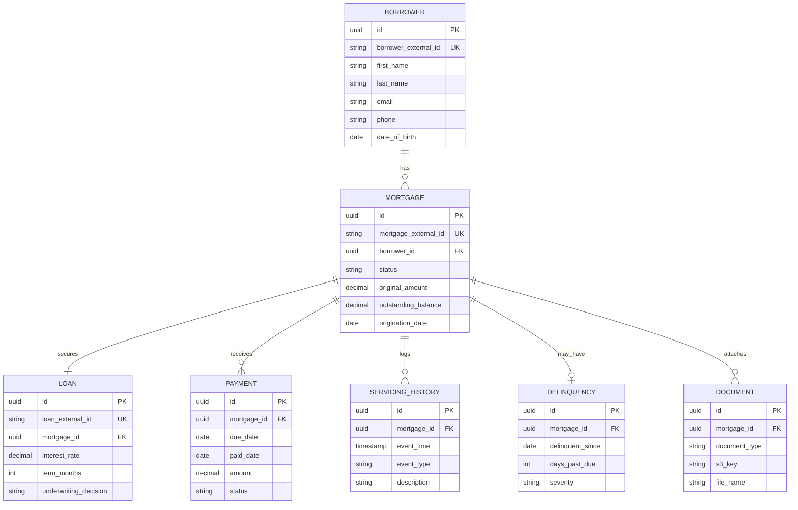

# Reference data model (capstone baseline)

Teams may extend this model in migrations (`002_*.sql`) with an ADR. **M2** should implement this baseline unless the instructor approves changes.

See also: [Engineering standards](./standards.md) (delinquency rule, IDs).

---

## Entity relationship (logical)



---

## Table summary

| Table | Purpose |
| --- | --- |
| `borrower` | Party on the loan |
| `mortgage` | Servicing unit; balance and status |
| `loan` | Terms and underwriting outcome |
| `payment` | Scheduled and posted payments |
| `servicing_history` | Chronological servicing events |
| `delinquency` | Current delinquency snapshot (1:1 active row per delinquent mortgage) |
| `document` | Metadata for S3-stored files |

---

## Recommended indexes

| Index | Columns | Reason |
| --- | --- | --- |
| `idx_mortgage_borrower` | `borrower_id` | Borrower portfolio queries |
| `idx_mortgage_status` | `status` | Delinquency reports |
| `idx_payment_mortgage_due` | `mortgage_id`, `due_date` | Payment history timeline |
| `idx_servicing_mortgage_time` | `mortgage_id`, `event_time` | Servicing API sort |
| `idx_document_mortgage` | `mortgage_id` | Document list |

---

## Demo seed IDs (use in tests and demos)

Document these in `database/README.md` after seeding:

| ID | Scenario |
| --- | --- |
| `BOR-001` | Primary demo borrower |
| `MTG-1001` | ACTIVE, on-time payments |
| `MTG-1002` | DELINQUENT, 45 days past due |
| `MTG-1003` | ACTIVE, recently onboarded |
| `LOAN-2001` | Linked to `MTG-1001`, APPROVED |

---

## Starter DDL

Copy and adapt into `database/migrations/001_core_schema.sql`. Full script: [sample-starter-schema.sql](../reference/sample-starter-schema.sql).

---

## Sample delinquency SQL (validation)

```sql
-- Mortgages marked DELINQUENT in seed (adjust table/column names if needed)
SELECT m.mortgage_external_id, m.status, d.days_past_due, d.delinquent_since
FROM mortgage m
LEFT JOIN delinquency d ON d.mortgage_id = m.id
WHERE m.status = 'DELINQUENT';
```

Expected: includes `MTG-1002` with `days_past_due >= 30`.
